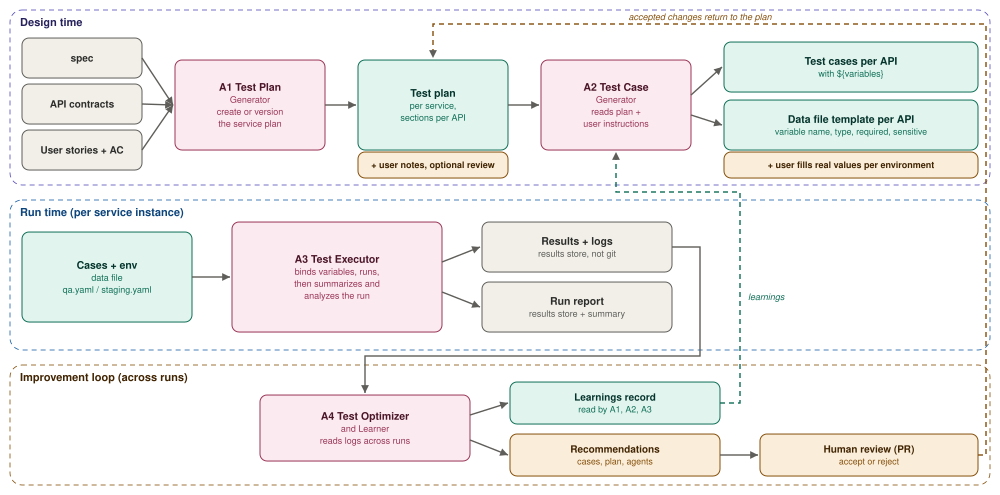

# QA Agent Framework

A generic, vendor-neutral framework in which agents plan, write, run, and improve tests for services, then for multi-service workflows.

Agents turn specs, user stories, and additional instructions into versioned test plans and test cases. A deterministic engine runs the cases and decides pass or fail. Agents summarize and analyze each run, and an optimizer learns across runs and proposes improvements. Everything lives in git except execution results and secrets.

> **Status:** requirements baselined (draft v11); detailed design drafted in [docs/design/](docs/design/README.md). The first working slice is next. See [docs/roadmap.md](docs/roadmap.md).

## The agents

| Agent | Turns | Into |
|---|---|---|
| **Test Plan Generator** | Spec, API contracts, user stories, additional instructions | A versioned test plan per service, with a section per API |
| **Test Case Generator** | The test plan plus anything people add to it | Test cases written with variables, a data file template per API, and plugin outputs |
| **Test Executor** | Test cases plus real values for one environment | Results and logs, then a run report with summary and analysis |
| **Test Optimizer and Learner** | Results and logs across runs | A learning record the other agents read, and recommendations as pull requests |
| *Validator Generator (on demand)* | A validation gap listed in a plan | A new, tested validator in the shared catalog |

Workflow agents follow the same pattern in a later phase: one plan and one set of cases per use case, chaining API calls across services.

## Principles

- **Generic framework, firm-specific content.** The framework names no firm or product. Every external system (issue tracker, wiki, secrets vault, results store, test management, CI/CD, tracing, agent runtime) is a connector chosen in one firm profile.
- **Expected results come from requirements**, never from reading the implementation.
- **The engine decides pass or fail.** Agents design tests and explain results; they never change a verdict.
- **Every step runs by default**; flags turn any step off or run only some. Nothing waits on a mandatory approval; review is a team process.
- **Generation never overwrites what people own:** instruction files, person-written plan sections, and hand-edited test cases.
- **Changes are tracked, not guessed.** Each plan records the source versions it came from, so changed APIs, stories, and instructions mark exactly the affected cases stale.
- **Results stay out of git**; secrets stay in a vault and are masked everywhere.

## Repository layout

This repository starts as one repo with two top-level folders; they split into separate repositories once the boundary is proven.

| Path | Contents |
|---|---|
| [`framework/`](framework/README.md) | Generic code: agent instructions, templates, schemas, validators, engine, connectors, plugins, tools |
| [`test-assets/`](test-assets/README.md) | Per-service content: plans, test cases, data files, instructions, learnings |
| [`docs/`](docs/) | Requirements, architecture, folder structure, agents, decisions, roadmap, glossary |

Results and secrets never live here. See [docs/folder-structure.md](docs/folder-structure.md).

## Documentation

| Document | What it covers |
|---|---|
| [Requirements](docs/requirements.md) | Full requirements baseline with diagrams and the decision log |
| [Architecture overview](docs/architecture.md) | How the pieces fit: agents, engine, connectors, stores, triggers |
| [Detailed design](docs/design/README.md) | Interfaces, schemas, step contracts, connector interfaces, and how every TBD item is resolved |
| [Agents](docs/agents.md) | Each agent's inputs, steps, flags, and outputs |
| [Folder structure](docs/folder-structure.md) | Repositories, folders, and what each file holds |
| [Versioning and change tracking](docs/versioning.md) | How changes in specs, stories, and instructions flow to plans and cases |
| [Decisions](docs/decisions.md) | Decisions taken and the defaults adopted |
| [Roadmap](docs/roadmap.md) | Phases and what comes next |
| [Glossary](docs/glossary.md) | Terms used across the documents |
| [Contributing](CONTRIBUTING.md) | Branches, pull requests, and naming rules |
