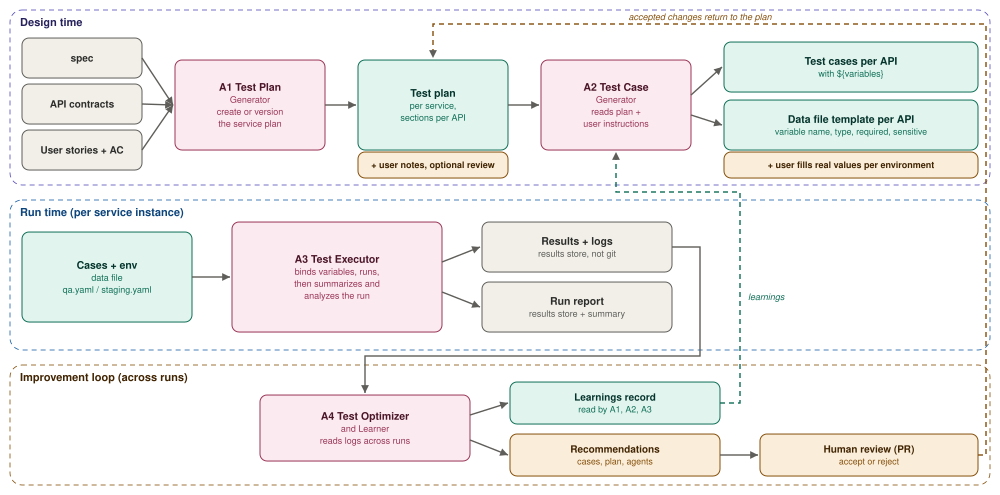
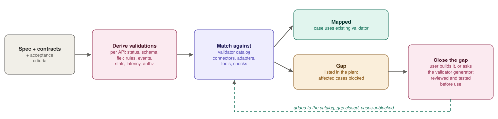
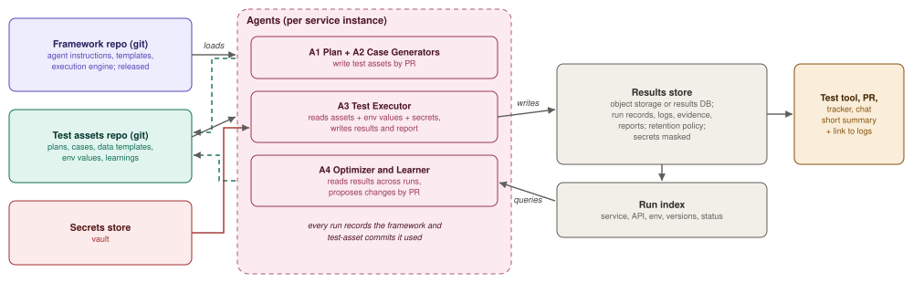
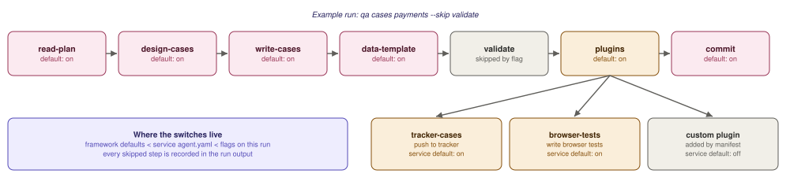
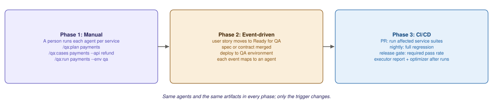

# Architecture overview

A short tour of how the framework fits together. The [requirements](requirements.md) hold the full detail; the [detailed design](design/README.md) finalizes names and interfaces.

## Building blocks

| Block | Role | Decides pass or fail? |
|---|---|---|
| **Agents** | Reason: read requirements, write plans and cases, analyze runs, recommend changes | No |
| **Engine** | Execute: bind variables, call services, apply validators, record results | Yes |
| **Validators** | Deterministic checks the engine applies (status codes, error codes, schemas, field rules, events, stored state, latency) | Yes, through the engine |
| **Connectors** | Reach external systems through fixed interfaces chosen in the firm profile | No |
| **Plugins** | Add outputs to an agent without changing it (for example pushing cases to the issue tracker) | No |
| **Guards** | Enforce non-production only, and keep agents out of person-owned files | Block, never decide |

## Flow

1. **Plan.** The Test Plan Generator scans the service and API folders, reads sources live (spec, contracts, user stories, instructions), compares them with `sources.lock`, and writes a new plan version covering only what changed.
2. **Cases.** The Test Case Generator reads the plan, including person-written instructions, and writes test cases with `${variables}` plus a data file template per API. Plugins run last.
3. **Run.** The Test Executor selects cases and calls the engine. The engine resolves values from the environment data file and secret references from the vault, checks that every required value exists, runs the cases, and writes results to the results store. Cases for a service version that is not deployed yet are reported as pending.
4. **Analyze.** The executor writes the run report: headline finding, failures classified, what to do differently.
5. **Improve.** The Optimizer and Learner reads runs across time, updates the learning record, and opens pull requests for anything else.

## Validations

Each plan lists, per API, the validations the spec requires and the catalog validator that checks each one. Anything without a validator is a validation gap; affected cases stay blocked until a person or the Validator Generator closes it.

## Storage

| Store | Holds | Kept in |
|---|---|---|
| Framework | Generic code | git |
| Test assets | Plans, cases, data templates, environment values, instructions, learnings | git |
| Results | Run records, logs, reports, recommendations, run index | Object storage, later a results database |
| Secrets | Real secret values | Vault |

## Steps, flags, and plugins

Every agent is a named list of steps, all on by default. Precedence: framework defaults, then the service's `agent.yaml`, then flags on the run. Every skipped step is recorded in the run output.

## Triggers

Phase 1 is manual, per service and per step. Phase 2 adds event triggers. Phase 3 runs the whole pipeline in CI/CD on commits, requirement changes, and regression schedules. Only the trigger changes between phases.

## Portability

Everything that differs between firms is a connector selected in a single firm profile: requirements, specs, instructions, secrets, results store, test management, CI/CD, interfaces, traces, service authentication, deployed version, and the agent runtime with its model access. See section 2.5 of the [requirements](requirements.md).
