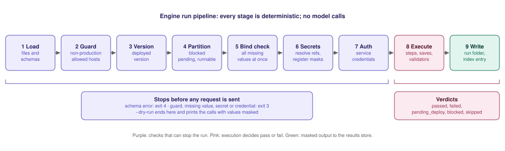
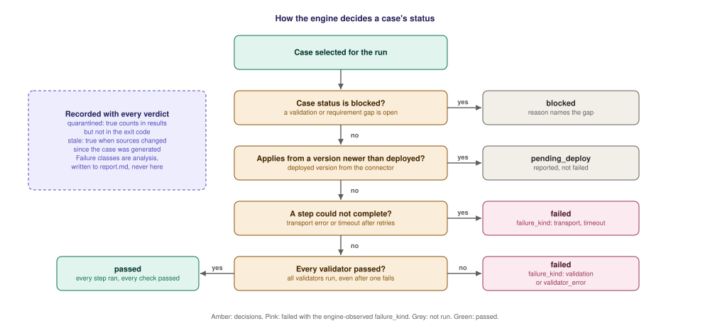

# 3. Engine

The engine is the only component that decides pass or fail. It makes no model calls and uses no randomness except the `${uuid}` built-in, whose values are logged. Given the same cases, data, and service responses, it produces the same verdicts (EX-5).



## 3.1 Entry point

```
qa-engine run --service <s> --env <e> [--api <a>] [--case <id>]... [--tag <t>]...
              [--assets <path>] [--assume-version <x.y.z>] [--parallel <n>]
              [--run-id <id>] [--dry-run]
```

The executor's `select-cases` step writes the chosen case ids to `select-cases.out.json`, and the `run` step calls `qa-engine run --cases-file <that file>`. Running `qa-engine` directly is supported for debugging and for CI images without agent tooling.

## 3.2 Pipeline

| # | Stage | Does | Stops the run when |
|---|---|---|---|
| 1 | Load | Reads `firm-profile.yaml`, the registry, `agent.yaml`, the selected cases, the data template, the environment data file and any `.local` override, and the validator catalog. Validates each against its schema | A file fails its schema (exit 4) |
| 2 | Guard | Checks `production: false` and that `base_url` matches `allowed_hosts` | Either check fails (exit 3) |
| 3 | Version | Asks the `deployed_version` connector for the service version, unless `--assume-version` is set | Never; an unknown version is recorded ([6.7](06-versioning.md#67-deployed-version-and-pending-cases)) |
| 4 | Partition | Splits cases into `blocked` (status blocked), `pending_deploy` (applies from a newer version), and runnable | Never |
| 5 | Bind check | For every runnable case and data set, resolves every variable except saved values and built-ins. Collects every missing or empty required value across all cases first | Any value is missing: prints all of them at once and exits 3 (EX-3) |
| 6 | Secrets | Resolves `${secret:...}` references through the `secrets` connector and registers each value with the masker | A reference cannot be resolved: lists all of them, exit 3 |
| 7 | Auth | Asks the `service_auth` connector for credentials when a case uses `${auth:<profile>}` | Credentials unavailable (exit 3) |
| 8 | Execute | Runs each case ([3.4](#34-running-a-case)) | Never; failures are verdicts |
| 9 | Write | Writes the run folder and the index entry through the `results_store` connector ([8](08-results-store.md)) | The store is unreachable: writes the run to `.local/runs/<run-id>/` and exits 6 with the path |

`--dry-run` stops after stage 7 and prints the plan of calls with masked values.

## 3.3 Binding

Resolution order for `${name}`: active data set, then `values` in the environment data file (with `.local` overrides applied first), then values saved by earlier steps of the same case and data set. Built-ins (`${uuid}`, `${now}`, `${run_id}`) are resolved once per case execution. Unknown names are a bind error reported in stage 5, not a runtime surprise. Saved values are only checked statically: `validate` confirms every saved name a step uses is saved by an earlier step.

## 3.4 Running a case

For each case and data set:

1. Run `setup` steps, then `steps`, in order. For each step:
   1. Substitute variables into the request.
   2. Send it through the interface adapter for `step.interface`.
   3. On a transport error (connection refused, DNS, TLS, timeout), retry up to `retries.transport` times from the environment. Each attempt is logged. Validator failures are never retried.
   4. Run **every** validator on the step, even after one fails, so the log has full evidence.
   5. Apply `save` to the response.
2. If a step fails (transport error after retries, or any validator failed), the remaining `steps` are recorded as `not_run`.
3. Run `teardown` steps. A failing teardown is logged as a warning and does not change the verdict.
4. Decide the verdict ([3.7](#37-verdict-rules)).

Each request carries a trace header (`traceparent` by default; the header name is set by the `traces` connector) with a new trace id per step, recorded in the log and in `results.json`.

## 3.5 Interface adapters

```python
class Adapter(Protocol):
    interface: str                                   # "rest", later "grpc", "events", "database"
    def send(self, request: Request, ctx: StepContext) -> Response: ...

@dataclass(frozen=True)
class Response:
    status: int | str | None        # HTTP status, gRPC code, or None for events and database steps
    headers: Mapping[str, str]
    body: Any                       # parsed JSON when the content type is JSON, else text
    elapsed_ms: int
    trace_id: str
    raw_size: int
```

Phase 1 ships the REST adapter. The gRPC, events, and database adapters arrive in Phase 2 and reach the systems they talk to through connectors chosen in the firm profile. Validators that need a second interface, such as `event_emitted` or `db_state`, read it from `ValidatorContext.interfaces`, never by opening their own connections.

## 3.6 Validators and the catalog

### Interface

```python
@dataclass(frozen=True)
class Result:
    passed: bool
    message: str                    # one line; names the field and both values on failure
    expected: Any = None
    observed: Any = None

@dataclass(frozen=True)
class ValidatorContext:
    step: str
    responses: Mapping[str, Response]   # every earlier step of this case, by step name
    saved: Mapping[str, Any]
    contract: ContractView | None       # read-only view of the API contract from the specs connector
    interfaces: Mapping[str, ReadOnlyInterface]   # events and database readers
    clock: Clock                        # injected so tests control time

def validate(response: Response, params: dict, ctx: ValidatorContext) -> Result: ...
```

Rules for every validator, checked by the framework's own tests:

- Deterministic: no model calls, no randomness, no writes. Time-window checks use `ctx.clock`.
- Parameters are validated against the catalog's `params` schema before the run starts; a bad parameter is a load error (exit 4), not a failed case.
- Returns `Result`; raising an exception is recorded as `failure_kind: validator_error` and fails the case, so a broken validator can never pass a case.

### Catalog entry (`validators/catalog.yaml`)

```yaml
validators:
  error_code:
    kind: error_code                 # validation kind from VL-6, used to match plan validations
    checks: Error body carries the expected business error code
    interface: rest                  # rest | grpc | events | database | any
    params:                          # JSON Schema for the `with:` block
      type: object
      required: [expected]
      properties:
        field: {type: string, default: body.code}
        expected: {type: string}
    module: validators/error_code.py
    tests: validators/tests/test_error_code.py
    owner: qa-platform
    version: 1.0.0
    status: active                   # proposed | active | deprecated
    replaced_by: null
```

Validation kinds (VL-6): `status_code`, `error_code`, `schema`, `field_rules`, `event`, `state`, `side_effect`, `latency`, `access_control`. The plan generator maps each required validation to a kind, then to active catalog entries of that kind and interface. No match makes a validation gap.

Phase 1 catalog: `http_status`, `error_code`, `json_schema`, `field_rules`, `latency`, `db_state` (against the local stand-in database). `event_emitted` arrives with the events adapter.

`field_rules` operators: `equals`, `not_equals`, `one_of`, `matches` (regular expression), `range` (`min`, `max`, inclusive), `exists`, `absent`, `type`, `length`.

A `deprecated` validator still runs; `validate` warns on cases that use it. Cases MUST NOT use a `proposed` validator. Each run records the version of every validator it used in `run.json`.

## 3.7 Verdict rules



| Status | When |
|---|---|
| `passed` | Every step ran and every validator returned `passed: true` |
| `failed` | Any validator failed, a step had a transport error after retries, or a validator raised. `failure_kind` says which: `validation`, `transport`, `timeout`, `validator_error` |
| `pending_deploy` | `applies_from_service_version` is newer than the deployed version |
| `blocked` | Case status is `blocked`; `reason` names the gap |
| `skipped` | Excluded by `--case`, `--tag`, or `--api` filters after selection, or the run was stopped by a case timeout budget; `reason` says which |

`failure_kind` is a fact the engine observed. The failure classes (product, test, data, environment, dependency, requirement gap, flaky) are the executor's analysis, written to `report.md` and never into `results.json` (EX-12).

A quarantined case gets a normal verdict plus `quarantined: true`; it is excluded from the exit code only.

## 3.8 Masking

The masker runs on every log line, result, and evidence file before it is written (EX-6, ST-5).

1. Every resolved secret value is registered at stage 6 and replaced by `***masked***` wherever it appears in any string, including inside larger strings, URL query strings, and base64 of the value.
2. Header names in a deny list are masked whatever their value: `authorization`, `proxy-authorization`, `cookie`, `set-cookie`, `x-api-key`, plus any in the environment's `mask_headers`.
3. Body fields whose variable is `type: secret` in the data template are masked by path, and any field named in `mask_fields` in `agent.yaml`.
4. Values shorter than 4 characters are not registered, to avoid masking noise; the data template validation rejects secrets that short.

A unit test seeds known secrets through every log path and fails if any appears unmasked.

## 3.9 Timeouts and concurrency

- Per request: `timeouts.request_s` (default 30). Per case: `timeouts.case_s` (default 300). A case that exceeds its budget fails with `failure_kind: timeout`.
- Cases in one run execute one at a time by default. `--parallel <n>` runs up to `n` cases at once; a case can opt out with `exclusive: true` (it then runs alone).
- Runs for different services, or the same service in different environments, are independent processes with their own run ids and run folders (EX-8). The only shared write is the run index, which uses one object per run ([8.2](08-results-store.md#82-run-index)).

## 3.10 Engine package layout

```
framework/engine/
  pyproject.toml                 qa-engine, version equals the framework release
  qa_engine/
    cli.py                       argument parsing, exit codes
    loader.py                    files and schemas
    guard.py                     non-production checks
    versions.py                  deployed version and gating
    binder.py                    variables, data sets, secret references
    masker.py
    adapters/rest.py             Phase 1
    runner.py                    case execution and verdicts
    validators.py                catalog loading and parameter checks
    results.py                   run folder and index entry
  tests/
```

Third-party dependencies are limited to a YAML parser, a JSON Schema validator, and an HTTP client, pinned in `pyproject.toml`.
