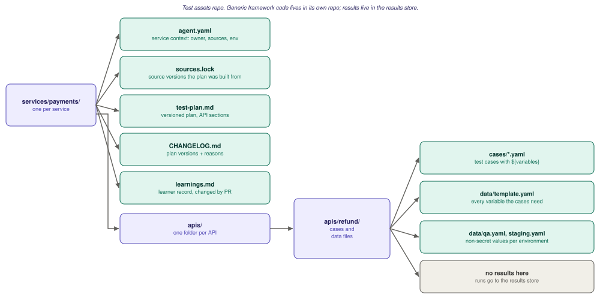

# Folder structure

Names are final as of the [detailed design](design/02-artifacts.md), which also adds `.local/work/` session folders and one run index object per run.

## Stores

| Store | Top-level contents | Who changes it |
|---|---|---|
| **Framework** (git) | `runtime/`, `AGENT_RULES.md`, `skills/`, `config/`, `templates/`, `schemas/`, `validators/`, `engine/`, `connectors/`, `plugins/`, `tools/`, `hooks/`, `docs/`, `firm-profile.example.yaml` | Framework team through pull requests; released with version tags |
| **Test assets** (git) | `firm-profile.yaml`, `registry/`, `instructions/`, `services/<service>/`, `workflows/` | Agents write through branches and pull requests; each team sets its own review process |
| **Results** (object storage, later a database) | `<service>/<date>/<run-id>/`, `index/`, `optimizer/` | Written only by the engine and the executor |
| **Secrets** (vault) | One entry per environment, service, and key | Platform or security team |

## Framework

| Path | Holds |
|---|---|
| `runtime/manifest.json` | Runtime-neutral manifest; the agent runtime connector turns it into the runtime's own plugin format |
| `AGENT_RULES.md` | Rules every agent session follows |
| `skills/<agent>/SKILL.md` | Instructions for each agent: plan-generator, case-generator, test-executor, optimizer-learner, validator-generator |
| `config/agents.yaml` | Default steps per agent; all on |
| `templates/` | Test plan, test case, data template, environment data, run report, learnings, recommendation, validator |
| `schemas/` | Machine-checkable shape of every artifact |
| `validators/` | `catalog.yaml`, shared validators, and their tests |
| `engine/` | Deterministic execution engine: variable binding, runner, interface adapters, version gating, results writer |
| `connectors/<concern>/` | One connector interface per external concern, plus implementations |
| `plugins/<name>/` | Optional outputs, each with a `plugin.yaml` manifest |
| `tools/` | `scan_layout`, `detect_changes`, `validate_artifacts`, `new_service`, `check_connector` |
| `hooks/` | Guards: non-production only; instruction files read-only for agents |
| `firm-profile.example.yaml` | Template for choosing one connector per concern |

## Test assets: inside `services/<service>/`

| Path | Holds |
|---|---|
| `agent.yaml` | Service context: owner, where the spec, contracts, and stories are, instruction sources, environments, step and plugin defaults |
| `sources.lock` | Versions and fingerprints of every source the current plan was built from (never page content) |
| `test-plan.md` | Versioned plan: per-API sections, validations, validation gaps, requirement questions, person-written instructions |
| `CHANGELOG.md` | One entry per plan version |
| `learnings.md` | The learner's record; each entry cites its runs |
| `instructions/` | Person-owned service instructions; agents read, never write |
| `plugins/` | Plugin state, for example the case-id to tracker-issue map |
| `apis/<api>/cases/` | One YAML file per test case, with `${variables}` and ticket tags |
| `apis/<api>/data/template.yaml` | Every variable the API's cases need |
| `apis/<api>/data/<env>.yaml` | Real values for one environment; secrets as vault references |
| `apis/<api>/instructions/` | Person-owned API instructions |
| `apis/<api>/generated/` | Plugin outputs; do not edit |

## Results: inside a run folder

| Path | Holds |
|---|---|
| `run.json` | Environment, trigger, versions used, counts, skipped steps, agent cost |
| `results.json` | Status per case: passed, failed, pending deploy, blocked, skipped |
| `logs/` | Requests, responses, validator results per case; secrets masked |
| `report.md` | The executor's summary and analysis |
| `evidence/` | Supporting files the report references |

## Git conventions

- Every agent change arrives as a branch and a pull request.
- Each service pins the framework version it uses in `agent.yaml`.
- Plans are tagged per service when a version is merged, for example `payments/plan-v1.2`.
- Code owners per service folder review test changes, when the team's process asks for review.
- Local data overrides (`*.local.yaml`) are ignored by git.
