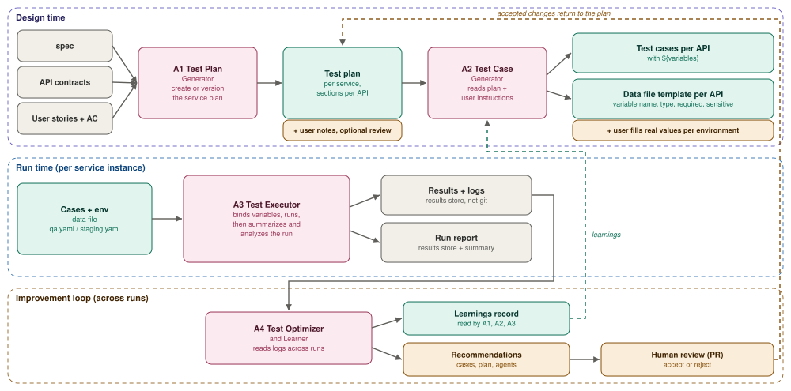
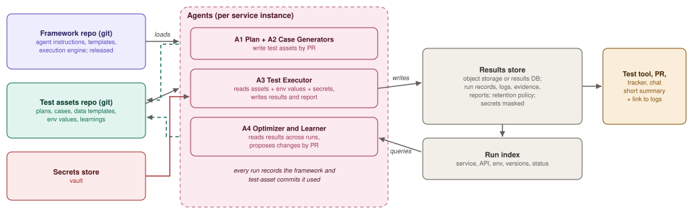
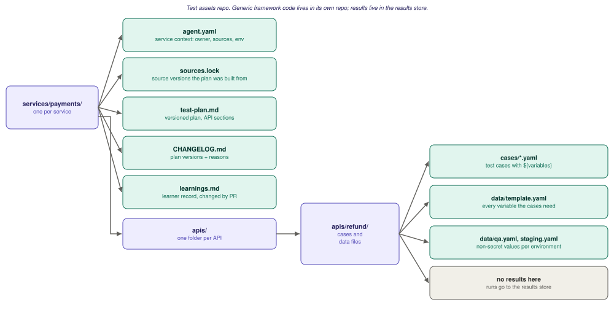
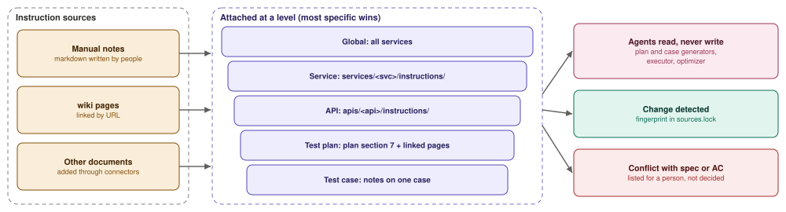
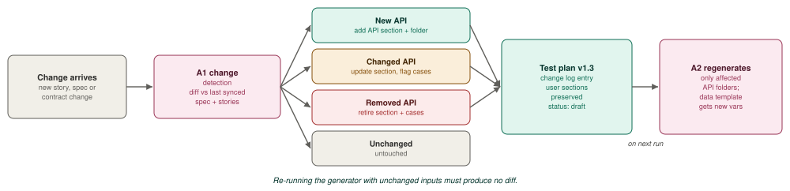
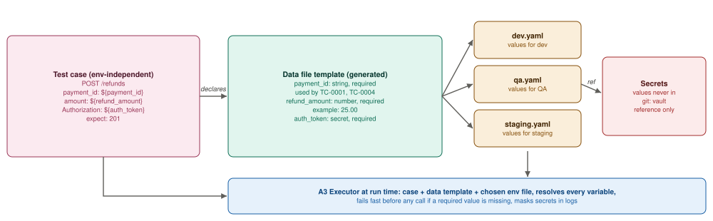
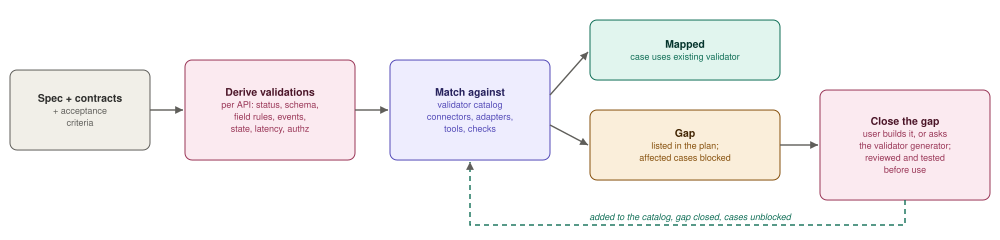
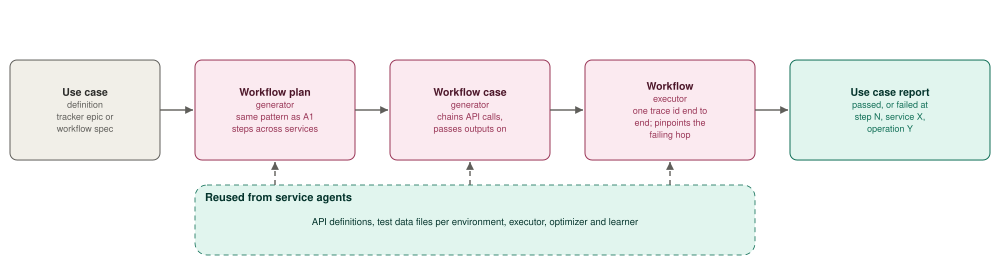
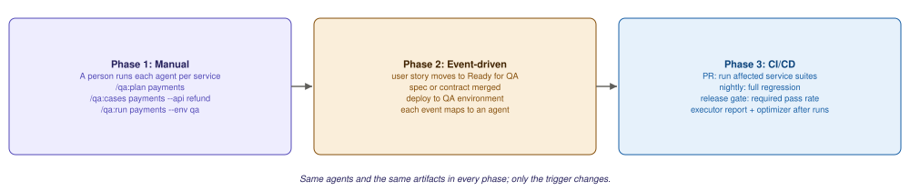

# QA Agent Framework: Requirements

*Requirements baseline (draft v11). Precedes the detailed design document.*

**In one paragraph.** A generic framework that produces and runs tests for each service with four agents. The **Test Plan Generator** turns a spec and user stories into a versioned test plan. The **Test Case Generator** turns that plan, plus anything a person adds to it, into test cases written with variables and a data file listing those variables. The **Test Executor** runs the cases with real values for a chosen environment, then summarizes and analyzes the run. The **Test Optimizer and Learner** reads execution logs across runs, recommends changes to the cases or the agents, and keeps what it learns for the other agents to use. Agents start as manual commands per service and later run on events and in CI/CD. Framework code, test assets, and execution results are stored separately: code and test assets in their own git repositories, results and logs in a results store outside git. A later phase adds workflow agents that chain API calls across services to test a complete use case.

**Source column:** *Stated* = requested by the product owner. *Proposed* = added during requirements review to make a stated requirement work; open to change.

## 1. Agents at a glance

| Agent                             | Reads                                                                                      | Produces                                                                                                                               | Human role                                    |
|-----------------------------------|--------------------------------------------------------------------------------------------|----------------------------------------------------------------------------------------------------------------------------------------|-----------------------------------------------|
| **A1 Test Plan Generator**        | spec and contracts, user stories and AC, additional instructions, existing plan, learnings | Test plan per service (new, or a new version)                                                                                          | Adds information and instructions; may review |
| **A2 Test Case Generator**        | Latest plan including user additions, additional instructions, learnings                   | Test cases per API with variables; data file template per API; plugin outputs such as test cases in the issue tracker or browser tests | Fills real values per environment; may review |
| **A3 Test Executor**              | Cases, data template, environment data file, learnings                                     | Results, execution logs, and a run report with summary and analysis                                                                    | Triggers the run (phase 1); reads the report  |
| **A4 Test Optimizer and Learner** | Logs and results across runs, cases, plan, agent instructions                              | Recommendations as pull requests; a learning record it updates directly                                                                | Merges or closes recommendations              |
| *Validator generator (on demand)* | A validation gap from the plan                                                             | A new validator with its own tests                                                                                                     | Requests it                                   |

**Figure 1. The four agents: design time, run time, and the improvement loop**

*Pink: agents. Green: test assets in git. Grey: results store, outside git. Amber: where people add input. Dashed: learnings feed the next generation and run; accepted recommendations return to the plan.*

## 2. Framework and structure

| ID    | Requirement                                                                                                                                                                                    | Source   |
|-------|------------------------------------------------------------------------------------------------------------------------------------------------------------------------------------------------|----------|
| FW-1  | All generic code (templates, agent instructions, schemas, the execution engine) lives in the framework and contains nothing service-specific.                                                  | Stated   |
| FW-2  | Each service has its own folder; inside it, each API has its own folder holding its cases and data files. Run outputs go to the results store (section 2.1).                                                                        | Stated   |
| FW-3  | Each service runs its own instance of the agents: the same generic agents, given that service's folder as context. Instances for different services run independently and can run in parallel. | Stated   |
| FW-4  | Test plans, cases, data templates, and learnings are stored in git. Execution results, logs, and secrets are not (section 2.1).                                                                | Stated   |
| FW-5  | The framework ships three templates: test plan, test case, data file. Agents must produce output that conforms to them.                                                                        | Stated   |
| FW-6  | Agents run in an agent runtime that supports skills, subagents, hooks, and plugins, interactively or headless for automation; the runtime is chosen per firm (section 2.5).                    | Stated   |
| FW-7  | A validator checks every generated artifact against its template before it can be committed.                                                                                                   | Proposed |
| FW-8  | The framework is built so the same agents, templates, and engine can later test multi-service workflows.                                                                                       | Stated   |
| FW-9  | No step is gated by a mandatory approval. Review and approval are team processes outside the framework.                                                                                        | Stated   |
| FW-10 | Interfaces in order: REST first, then gRPC, events, and databases as services need them.                                                                                                       | Proposed |

### 2.1 Where things are stored

| ID    | Requirement                                                                                                                                                                                                         | Source   |
|-------|---------------------------------------------------------------------------------------------------------------------------------------------------------------------------------------------------------------------|----------|
| ST-1  | Execution results and logs are kept separate from the framework code and the test plans and cases.                                                                                                                  | Stated   |
| ST-2  | Three stores: a framework repo (generic code, released and versioned), a test assets repo (plans, cases, data templates, non-secret environment values, learnings), and a results store.                            | Proposed |
| ST-3  | The results store is object storage or a results database, not git, because logs are large, grow every run, may contain sensitive request data, and are written by parallel instances.                              | Proposed |
| ST-4  | Every run writes an index entry: service, API, environment, run id, status, timings, and the framework and test-asset commits it used, so the optimizer can query across runs.                                      | Proposed |
| ST-5  | Results have a retention period per environment, and secrets are masked before anything is written.                                                                                                                 | Proposed |
| ST-6  | Run results sync to the test management tool (results only; git stays the source of truth for plans and cases). Short summaries can also go to the PR, the issue tracker, or chat, with a link to the full results. | Proposed |
| ST-7  | Learnings and optimizer recommendations come back into the test assets repo only through pull requests.                                                                                                             | Proposed |
| ST-8  | Real secret values live in a vault; data files hold references to them.                                                                                                                                             | Stated   |
| ST-9  | All services share one central test assets repo (or one per domain), so later workflow agents can reach every service.                                                                                              | Proposed |
| ST-10 | The results store starts as a shared object storage bucket with an index entry per run; a results database is added when dashboards are needed.                                                                     | Proposed |

**Figure 7. Storage: two git repositories, a results store, and a secrets store**

*Solid: reads and writes at run time. Dashed green: changes proposed back to git by pull request.*

### 2.2 Repositories and folder structure

High-level layout. A sample of this structure with example files accompanies this document (qa-framework-sample-structure.zip); exact names are finalized in the design document.

| Store                                        | Top-level contents                                                                                                                                                            | Purpose                                                     | Who changes it                                                                         |
|----------------------------------------------|-------------------------------------------------------------------------------------------------------------------------------------------------------------------------------|-------------------------------------------------------------|----------------------------------------------------------------------------------------|
| **Framework repo** (git)                     | `runtime/`, `AGENT_RULES.md`, `skills/` (one folder per agent), `templates/`, `schemas/`, `validators/` (catalog + shared validators), `engine/`, `tools/`, `hooks/`, `docs/` | Generic code shared by every service                        | Framework team through pull requests; released with version tags                       |
| **Test assets repo** (git)                   | `registry/` (services, environments), `services/<service>/`, `workflows/` (later phase)                                                                                       | Plans, cases, data templates, environment values, learnings | Agents write through branches and pull requests; each team sets its own review process |
| **Results store** (bucket, later a database) | `<service>/<date>/<run-id>/`, `index/`, `optimizer/`                                                                                                                          | Run records, logs, reports, recommendations                 | Written only by the engine and the executor                                            |
| **Secrets store** (vault)                    | One entry per environment, service, and key                                                                                                                                   | Real secret values                                          | Platform or security team                                                              |

| Inside `services/<service>/`    | What it holds                                                                                                                     |
|---------------------------------|-----------------------------------------------------------------------------------------------------------------------------------|
| `agent.yaml`                    | Service context for every agent instance: owner, where the spec, contracts, and user stories are, framework version, environments |
| `sources.lock`                  | Spec commit, contract version, and story and acceptance-criteria fingerprints the current plan was built from                     |
| `test-plan.md`                  | The versioned plan: per-API sections, validator mapping, validation gaps, requirement questions, person-written instructions      |
| `CHANGELOG.md`                  | One entry per plan version: what changed and why                                                                                  |
| `learnings.md`                  | The learner's record, each entry citing the runs behind it                                                                        |
| `instructions/`                 | Person-written notes for the whole service; never changed by agents                                                               |
| `apis/<api>/instructions/`      | Person-written notes for one API                                                                                                  |
| `apis/<api>/cases/`             | One file per test case, written with variables                                                                                    |
| `apis/<api>/data/template.yaml` | Every variable the API's cases need                                                                                               |
| `apis/<api>/data/<env>.yaml`    | Real values for one environment; secrets as references                                                                            |

| Inside a run folder in the results store | What it holds                                                       |
|------------------------------------------|---------------------------------------------------------------------|
| `run.json`                               | Environment, trigger, versions used, counts, agent cost             |
| `results.json`                           | Status per case: passed, failed, pending deploy, blocked, skipped   |
| `logs/`                                  | Requests, responses, and validator results per case, secrets masked |
| `report.md`                              | The executor's summary and analysis                                 |
| `evidence/`                              | Supporting files referenced by the report                           |

**Git conventions (proposed):** every agent change arrives as a branch and pull request; each service pins the framework version it uses; plans are tagged per service when a version is merged (for example `payments/plan-v1.2`); code owners per service folder approve test changes; local data overrides are ignored by git.

**Figure 3. Service and API folders in the test assets repo**

*Names are placeholders for the design document to finalize.*

### 2.3 Additional instructions

Guidance beyond user stories and the spec: manual notes, wiki pages, and similar documents that tell the agents what matters and how to test it. People own them; agents only read them.

| ID    | Requirement                                                                                                                                                                              | Source   |
|-------|------------------------------------------------------------------------------------------------------------------------------------------------------------------------------------------|----------|
| AI-1  | Agents accept additional instructions beyond user stories and the spec, such as manually written notes and wiki pages.                                                                   | Stated   |
| AI-2  | Instructions can be attached per service, per API, and per test plan.                                                                                                                    | Stated   |
| AI-3  | Instructions can also be attached globally (all services) and to a single test case.                                                                                                     | Proposed |
| AI-4  | Instructions can be added or expanded at any time without changing the framework.                                                                                                        | Stated   |
| AI-5  | New kinds of instruction sources (other wikis, shared documents) are added through connectors.                                                                                           | Proposed |
| AI-6  | Generation never overwrites or edits these instructions.                                                                                                                                 | Stated   |
| AI-7  | Manual notes live in an `instructions/` folder at each level; external pages are listed by link in the service's `agent.yaml` with the level they apply to.                              | Proposed |
| AI-8  | Agents read every instruction that applies to their scope; the more specific level wins (test case, then test plan, then API, then service, then global).                                | Proposed |
| AI-9  | External pages are fingerprinted in `sources.lock`; when one changes, affected plan sections and cases are flagged, the same as a spec change.                                           | Proposed |
| AI-13 | Wiki and other external pages are read live through a connector each time an agent runs. No copies are stored in any repository, so instructions can never be duplicated or out of sync. | Stated   |
| AI-14 | sources.lock records only each page's version and fingerprint, not its content, so runs stay traceable without a copy.                                                                   | Proposed |
| AI-15 | If an external page cannot be reached, the agent stops and reports which page, rather than generating without it.                                                                        | Proposed |
| AI-10 | Instructions guide what to test and how. When one contradicts acceptance criteria, the spec, or a contract, the agent lists the conflict for a person instead of choosing.               | Proposed |
| AI-11 | Each generated plan item or case records which instructions influenced it.                                                                                                               | Proposed |
| AI-12 | A guard blocks agents from writing to instruction folders.                                                                                                                               | Proposed |

**Figure 9. Additional instructions: sources, levels, and how agents use them**

*Folder names are placeholders for the design document.*

### 2.4 Steps, flags, and plugins

Every agent is a fixed list of named steps. All steps run by default; flags turn any of them off or run only some. Plugins add outputs without changing the agent. Step names below are proposals for the design document to finalize.

| ID   | Requirement                                                                                                                                                                                              | Source   |
|------|----------------------------------------------------------------------------------------------------------------------------------------------------------------------------------------------------------|----------|
| SF-1 | Every step of every agent runs by default.                                                                                                                                                               | Stated   |
| SF-2 | Flags let a person or a pipeline turn any step off, or run only chosen steps, on a given run.                                                                                                            | Stated   |
| SF-3 | Each agent is a named list of steps, so flags can refer to steps by name (for example `--skip validate`, `--only write-cases`).                                                                          | Proposed |
| SF-4 | Defaults can be changed per service in `agent.yaml`; flags on a run override them.                                                                                                                       | Proposed |
| SF-5 | Every skipped step is recorded in the run's output, so results always show what did not run.                                                                                                             | Proposed |
| SF-6 | A step that needs output from a skipped step uses the last saved output and says so, or stops with a clear message.                                                                                      | Proposed |
| SF-7 | The same flags work when an agent runs manually, on an event, or in CI/CD.                                                                                                                               | Proposed |
| SF-8 | A flag lets a person or pipeline overwrite the plan and test cases for one run, instead of the default policy of writing nothing when nothing changed and marking invalid cases obsolete. | Stated   |
| PL-1 | The test case generator supports plugins that produce extra outputs, for example adding test cases to the issue tracker or test management tool or generating tests for a browser or API test framework. | Stated   |
| PL-2 | New plugins can be added without changing the agent.                                                                                                                                                     | Stated   |
| PL-3 | Each plugin has a manifest: name, what it produces, where it writes, the connector it needs, and its version.                                                                                            | Proposed |
| PL-4 | Test cases in git stay the source of truth. Plugin outputs are generated from them one way, matched by case id so nothing is duplicated, and refreshed when cases change.                                | Proposed |
| PL-5 | Plugins are steps: on or off per service in `agent.yaml` and per run by flag.                                                                                                                            | Proposed |
| PL-6 | A failing plugin is reported and does not stop the other steps.                                                                                                                                          | Proposed |
| PL-7 | The same plugin mechanism is available to the other agents, for example the executor running a generated browser test suite or posting a report to chat.                                                 | Proposed |

| Agent                    | Default steps (all on)                                                           |
|--------------------------|----------------------------------------------------------------------------------|
| A1 Test Plan Generator   | scan-layout, read-sources, detect-changes, write-plan, version, validate, commit |
| A2 Test Case Generator   | read-plan, design-cases, write-cases, data-template, validate, plugins, commit   |
| A3 Test Executor         | select-cases, check-data, run, analyze, report, publish                          |
| A4 Optimizer and Learner | query-runs, analyze, update-learnings, recommend, open-pr                        |

**Figure 1. The four agents: design time, run time, and the improvement loop**

*Pink: agents. Green: test assets in git. Grey: results store, outside git. Amber: where people add input. Dashed: learnings feed the next generation and run; accepted recommendations return to the plan.*0

### 2.5 Portability

The framework works in any firm. Everything that differs between firms is a connector chosen in one firm profile; agents, templates, validators, and test assets never change when a tool changes.

| ID   | Requirement                                                                                                                                                                           | Source   |
|------|---------------------------------------------------------------------------------------------------------------------------------------------------------------------------------------|----------|
| PT-1 | The framework and its documents name no firm, product, or project. Firm-specific choices live only in the firm profile and its connectors.                                            | Stated   |
| PT-2 | Every external system is reached through a connector with a fixed interface (table below).                                                                                            | Proposed |
| PT-3 | One firm profile file selects a connector for each concern. Switching a tool changes the profile and the connector only.                                                              | Proposed |
| PT-4 | A conformance test kit checks each connector before a firm uses it.                                                                                                                   | Proposed |
| PT-5 | Runtime-specific packaging (plugin manifest, hook wiring, rules file) is produced from the framework by a runtime connector, so agent instructions are not tied to one agent runtime. | Proposed |
| PT-6 | Firms without written acceptance criteria or API contracts can still run the framework; agents report the missing requirements as gaps.                                               | Proposed |

| Concern                        | Connector provides                                              | Examples of what a firm plugs in                     |
|--------------------------------|-----------------------------------------------------------------|------------------------------------------------------|
| Requirements                   | Stories, acceptance criteria, statuses, change events           | The firm's issue tracker                             |
| Specs and contracts            | Spec text, API contracts, versions                              | Spec documents and contract files in git             |
| Additional instructions        | Pages with version and fingerprint, read live                   | The firm's wiki or document system                   |
| Secrets                        | Resolve a reference at run time                                 | The firm's secrets vault                             |
| Results store                  | Write runs, query the run index                                 | Object storage or a results database                 |
| Test management                | Push results; optionally push cases                             | The firm's test management tool                      |
| CI/CD and events               | Trigger agents, pass flags, report status                       | The firm's CI/CD system and webhooks                 |
| Interfaces                     | Send requests, read events and state                            | REST, gRPC, event brokers, databases                 |
| Traces                         | Spans for a trace id                                            | The firm's tracing backend                           |
| Service authentication         | Credentials for test calls                                      | Tokens, OAuth client credentials, mutual TLS         |
| Deployed version               | Version of each service per environment                         | A version endpoint or deploy metadata                |
| Agent runtime and model access | Run skills and agents with tools, hooks, plugins, headless mode | The firm's approved agent runtime and model endpoint |

## 3. A1: Test Plan Generator

| ID    | Requirement                                                                                                                                           | Source   |
|-------|-------------------------------------------------------------------------------------------------------------------------------------------------------|----------|
| TP-1  | One test plan per service, with a section per API. This can change to one plan per API later if needed.                                               | Stated   |
| TP-2  | Inputs: the service's spec (and plan and API contracts) and its user stories with acceptance criteria.                                                | Stated   |
| TP-3  | The generator detects which services and folders already exist, then creates the missing folders and files or updates the existing ones.              | Stated   |
| TP-4  | Test plans are tagged with the tickets they cover, at plan level and per API section.                                                                 | Stated   |
| TP-5  | Output: a test plan built from the framework's test plan template.                                                                                    | Stated   |
| TP-6  | If the service has no agent yet: create the service folder, its agent configuration, and plan version 1.                                              | Stated   |
| TP-7  | If the service already exists and a new API or a changed API appears: produce a new plan version that covers the change.                              | Stated   |
| TP-8  | The plan has sections a person can edit to add information and instructions for test case generation.                                                 | Stated   |
| TP-9  | Updates never overwrite the person-edited sections.                                                                                                   | Proposed |
| TP-10 | Each version records a change log entry: what changed, which story or spec change caused it, which APIs are affected.                                 | Proposed |
| TP-11 | Removed APIs or removed acceptance criteria are marked retired, not deleted, so history stays traceable.                                              | Proposed |
| TP-12 | The plan lists gaps it finds: acceptance criteria with no spec, spec values that differ from the contract, criteria that cannot be tested as written. | Proposed |
| TP-13 | Every plan item traces to a story, acceptance criterion, or spec section.                                                                             | Proposed |
| TP-14 | A2 can run on any plan version at any time; it records which version it used. Reviewing a plan is a team choice, never a gate.                        | Stated   |

### 3.1 Proposed test plan template sections

| Section                                 | Content                                                                                                                                               | Written by   |
|-----------------------------------------|-------------------------------------------------------------------------------------------------------------------------------------------------------|--------------|
| Service overview                        | Purpose, owner, sources and versions used                                                                                                             | A1           |
| Scope and out of scope                  | What this plan tests and what it does not                                                                                                             | A1, editable |
| Per API                                 | Endpoint or operation, behaviors to test, test types (functional, negative, boundary, contract, event, data), priority, dependencies, test data needs | A1           |
| Gaps and questions                      | Requirement gaps found, owner to resolve                                                                                                              | A1           |
| Environments and entry/exit criteria    | Where tests run; what must be true to start and to pass                                                                                               | A1, editable |
| Additional information and instructions | Anything a person wants the case generator to know or do                                                                                              | Person only  |
| Change log                              | One entry per version                                                                                                                                 | A1           |

**Figure 4. Versioning when a new or changed API appears**

*Only affected API sections and folders change; everything else is left as it was. Change tracking basics are in section 8.*

## 4. A2: Test Case Generator

| ID    | Requirement                                                                                                                                       | Source   |
|-------|---------------------------------------------------------------------------------------------------------------------------------------------------|----------|
| TC-1  | Reads the test plan, including everything a person added to it.                                                                                   | Stated   |
| TC-2  | Generates test cases from the framework's test case template and stores them in the matching API folder.                                          | Stated   |
| TC-3  | Test cases use variables for every input and environment-specific value, never literal environment values.                                        | Stated   |
| TC-4  | Generates a data file template per API listing every variable its cases need.                                                                     | Stated   |
| TC-5  | For each variable the template records name, type, description, required or optional, example, whether it is a secret, and which cases use it.    | Proposed |
| TC-6  | People provide real values in one data file per environment; moving to a new environment never requires changing a test case.                     | Stated   |
| TC-7  | Expected results come from requirements (stories, spec, contracts), never from reading the implementation.                                        | Proposed |
| TC-8  | Generators never overwrite. When nothing changed, nothing is written. When the plan changes, existing cases keep their test content; a case that is no longer valid is marked obsolete and tagged with the reason, and a new case covers the changed requirement. No duplicate cases. | Stated   |
| TC-9  | Every case traces to a plan item and to a story or acceptance criterion.                                                                          | Proposed |
| TC-10 | Test cases are tagged with their tickets.                                                                                                         | Stated   |
| TC-11 | Data files are YAML; a case may list several named data sets to run the same steps with different values.                                         | Proposed |

**Figure 2. Test cases with variables, data file template, and environment data files**

*Illustrative variable names.*

## 5. Validations and validators

A validation is one thing a test must check. A validator is the reusable piece that checks it: a connector, adapter, tool, or check function.

| ID    | Requirement                                                                                                                                                                                                                                    | Source   |
|-------|------------------------------------------------------------------------------------------------------------------------------------------------------------------------------------------------------------------------------------------------|----------|
| VL-1  | From the spec, determine the validations each API needs.                                                                                                                                                                                       | Stated   |
| VL-2  | Validations use existing validators: connectors, adapters, tools.                                                                                                                                                                              | Stated   |
| VL-3  | When no existing validator fits, the validation is listed as a gap.                                                                                                                                                                            | Stated   |
| VL-4  | For each gap, a person can build the validator or ask a generator to create it.                                                                                                                                                                | Stated   |
| VL-5  | The framework repo keeps the validator catalog: name, what it checks, interface (REST, gRPC, events, database, files), parameters, owner, version.                                                                                             | Proposed |
| VL-11 | The validator generator is its own agent, run on demand for a specific gap.                                                                                                                                                                    | Proposed |
| VL-6  | Validation kinds considered: status and error codes, response schema against the contract, field values and business rules, events emitted or not emitted, persisted state, downstream side effects, response time limits, and access control. | Proposed |
| VL-7  | The test plan lists, per API, the validations required and the validator each one uses; gaps go in a Validation gaps section stating what is needed and why.                                                                                   | Proposed |
| VL-8  | Test cases may only use validators in the catalog. A case that needs a missing validator is blocked until the gap is closed.                                                                                                                   | Proposed |
| VL-9  | Generated validators are deterministic code and must pass their own tests before they enter the catalog.                                                                                                                                       | Proposed |
| VL-10 | Validators are shared across services and, later, workflows; a validator built for one service is available to all.                                                                                                                            | Proposed |

**Figure 8. From spec to validations: use what exists, list the gaps, close them**

*Details of the catalog format and the validator generator are TBD in the design document.*

## 6. A3: Test Executor (runs, summarizes, analyzes)

### 6.1 Execution

| ID   | Requirement                                                                                                                                                           | Source   |
|------|-----------------------------------------------------------------------------------------------------------------------------------------------------------------------|----------|
| EX-1 | Executes test cases for one service: all, one API, one case, or by tag.                                                                                               | Stated   |
| EX-2 | Binds variables from the chosen environment data file at run time.                                                                                                    | Stated   |
| EX-3 | Checks before any call that every required variable has a value, and reports all missing ones at once.                                                                | Proposed |
| EX-4 | Writes results and detailed execution logs per run: requests, responses, timings, trace ids.                                                                          | Stated   |
| EX-5 | The executor agent selects what to run and calls a deterministic engine; the engine sends requests and decides pass or fail, so the same inputs give the same result. | Proposed |
| EX-6 | Masks secret values in every log and report.                                                                                                                          | Proposed |
| EX-7 | Runs only against non-production environments.                                                                                                                        | Proposed |
| EX-8 | Instances for different services can run at the same time without interfering.                                                                                        | Stated   |

### 6.2 Summary and analysis

| ID    | Requirement                                                                                                        | Source   |
|-------|--------------------------------------------------------------------------------------------------------------------|----------|
| EX-9  | After each run, the executor summarizes it: what ran, what passed and failed, and what it found.                   | Stated   |
| EX-10 | The executor analyzes failures and says what to do differently.                                                    | Stated   |
| EX-11 | Each failure is classified: product defect, test defect, data, environment, dependency, requirement gap, or flaky. | Proposed |
| EX-12 | Analysis never changes a pass or fail result; it explains results after they are decided.                          | Proposed |
| EX-13 | The report leads with the most important finding and links every claim to the log or result it came from.          | Proposed |
| EX-14 | The report is saved in the service's reports folder and can be posted to a PR, the issue tracker, or chat.         | Proposed |

## 7. A4: Test Optimizer and Learner

### 7.1 Optimizer

| ID   | Requirement                                                                                                                                   | Source   |
|------|-----------------------------------------------------------------------------------------------------------------------------------------------|----------|
| OP-1 | Reads execution logs and results.                                                                                                             | Stated   |
| OP-2 | Recommends changes to test cases or to the agents themselves.                                                                                 | Stated   |
| OP-3 | Looks across many runs, not one, so it can see trends.                                                                                        | Proposed |
| OP-4 | May also recommend changes to the plan, data files, and templates.                                                                            | Proposed |
| OP-5 | Changes to cases, plans, data, or agent instructions arrive as pull requests; the optimizer never merges its own changes.                     | Proposed |
| OP-6 | Typical recommendations: flaky cases, redundant cases, coverage gaps against the plan, slow cases, data problems, unclear agent instructions. | Proposed |
| OP-7 | Each recommendation states the evidence, the expected benefit, and the exact change.                                                          | Proposed |

### 7.2 Learner

| ID   | Requirement                                                                                                                                                     | Source   |
|------|-----------------------------------------------------------------------------------------------------------------------------------------------------------------|----------|
| LN-1 | Learns from what happens across runs.                                                                                                                           | Stated   |
| LN-2 | Keeps a learning record per service, updated directly: known flaky cases, environment quirks, recurring data problems, failure patterns and their usual causes. | Proposed |
| LN-3 | A1, A2, and A3 read the learning record on their next run, so plans, cases, and analysis improve without anyone re-explaining.                                  | Proposed |
| LN-4 | Every learning entry cites the runs that support it and is dropped when later runs contradict it.                                                               | Proposed |
| LN-5 | Learnings shape guidance and analysis only; they never change expected results or pass and fail rules.                                                          | Proposed |

## 8. Change and version tracking

The basics only. Detection rules and the exact versioning scheme are TBD in the design document.

| ID   | Requirement                                                                                                                                                                  | Source   |
|------|------------------------------------------------------------------------------------------------------------------------------------------------------------------------------|----------|
| CV-1 | Detect when an API, the spec, or a user story changes for a service.                                                                                                         | Stated   |
| CV-2 | Each service keeps a record of the source versions its current plan was built from: spec commit, contract version, and a fingerprint of each story and acceptance criterion. | Proposed |
| CV-3 | On each A1 run, compare current sources with that record and list what was added, changed, or removed, per API and per acceptance criterion.                                 | Proposed |
| CV-4 | A change produces a new plan version with a change log, and only the affected plan sections and test cases are updated.                                                      | Stated   |
| CV-5 | Each test case records the plan version and requirement it came from, so out-of-date cases are found automatically.                                                          | Proposed |
| CV-6 | Every run records the framework version, test-asset version, and deployed service version it used.                                                                           | Proposed |
| CV-7 | Cases written for a service version not yet deployed are reported as pending, not failed.                                                                                    | Proposed |
| CV-8 | Versions are kept in git history: one plan file with a version number, a change log, and a tag per merged version; no copied v1/v2 files.                                    | Proposed |

**TBD in the design document:** version numbering (per service, per API, or both); what counts as a breaking change; which ticket statuses trigger an update; how the deployed service version is discovered; handling of side-by-side API versions such as /v1 and /v2; merging changes into cases a person edited by hand; how workflows track the API versions of the services they call.

## 9. Workflow agents (later phase)

| ID   | Requirement                                                                                                                  | Source   |
|------|------------------------------------------------------------------------------------------------------------------------------|----------|
| WF-1 | Workflow agents come in a later phase and follow the same pattern as service agents.                                         | Stated   |
| WF-2 | A workflow agent tests a complete use case by chaining API calls across services.                                            | Stated   |
| WF-3 | Workflows are built from a use case definition (a tracker epic or a workflow spec).                                          | Proposed |
| WF-9 | Each workflow has its own test plan and its own test cases.                                                                  | Stated   |
| WF-4 | Workflow steps call each service's existing API definitions and reuse its environment data files instead of redefining them. | Proposed |
| WF-5 | Outputs of one step (for example an order id) pass into later steps as variables.                                            | Proposed |
| WF-6 | One trace id follows the request end to end, so a failure is reported as the exact step, service, and API where it happened. | Proposed |
| WF-7 | A workflow reports which of its services have no passing tests yet, so a failure is not blamed on the workflow.              | Proposed |
| WF-8 | The executor and the optimizer and learner are reused for workflows.                                                         | Proposed |

**Figure 6. Workflow agents: same pattern, spanning services**

*Scope for the later phase; the service framework is designed so these pieces carry over.*

## 10. Triggers and automation

| ID   | Requirement                                                                                                         | Source   |
|------|---------------------------------------------------------------------------------------------------------------------|----------|
| TR-1 | Phase 1: every agent is triggered manually, per service.                                                            | Stated   |
| TR-2 | Phase 2: agents are triggered by events (for example a story change, a spec change, a deploy).                      | Stated   |
| TR-3 | Phase 3: agents run inside CI/CD pipelines.                                                                         | Stated   |
| TR-4 | Moving between phases changes only the trigger, never the agents or artifacts.                                      | Proposed |
| TR-5 | Everything is automated end to end once phase 3 is in place.                                                        | Stated   |
| TR-6 | Any single step (plan, cases, run, optimize) can be run on its own, manually or on demand, at any time.             | Stated   |
| TR-7 | Later, the whole pipeline can run automatically in CI/CD on commits, requirement changes, and regression schedules. | Stated   |

**Figure 5. Three trigger phases**

*Example commands and events; final names belong to the design document.*

## 11. Non-functional requirements

| ID   | Requirement                                                                                                                                         | Source   |
|------|-----------------------------------------------------------------------------------------------------------------------------------------------------|----------|
| NF-1 | Traceability: story, plan item, case, run result, and report link to each other.                                                                    | Proposed |
| NF-2 | Visibility: every generated change arrives as a reviewable diff, so teams can review when their process asks for it.                                | Proposed |
| NF-3 | Security: secrets are referenced from a vault, never committed or logged; access to the results store is restricted because logs hold request data. | Proposed |
| NF-4 | Repeatability: regenerating from unchanged inputs produces no changes.                                                                              | Proposed |
| NF-5 | Audit: every agent run records who or what triggered it, inputs, outputs, cost, and commit.                                                         | Proposed |
| NF-6 | Cost control: a spending cap per agent run and a switch to turn all agents off.                                                                     | Proposed |

## 12. Decision log

All open questions are closed. "Owner" marks a decision made by the product owner; "Default" marks the recommended default adopted because the question was left open. Any of them can be revisited before the design document. Also decided earlier by the product owner: four agents with summary and analysis inside the executor, results kept outside git, workflow agents in a later phase.

| \#     | Question                                         | Decision                                                                                                                                                                                                                                       | By            |
|--------|--------------------------------------------------|------------------------------------------------------------------------------------------------------------------------------------------------------------------------------------------------------------------------------------------------|---------------|
| Q1     | Plan granularity                                 | One test plan per service with a section per API; can change to per API later. Plans and cases tagged with tickets. The generator detects existing services and folders and creates or updates them. Each workflow has its own plan and cases. | Owner           |
| Q2     | How versions are kept                            | Git history, a version number in each plan, a change log, and a tag per merged version                                                                                                                                                         | Default       |
| Q3     | Data file format                                 | YAML; a case may list several named data sets                                                                                                                                                                                                  | Default       |
| Q4     | Where secret values live                         | A vault; data files hold references only                                                                                                                                                                                                       | Owner           |
| Q5     | How the executor runs tests                      | The agent selects what to run and calls a deterministic engine, then summarizes and analyzes                                                                                                                                                   | Default       |
| Q6     | Mandatory approvals                              | None. Review and approval are team processes outside the framework. Every step can run manually or on demand; later the whole pipeline runs in CI/CD on commits, changes, and regression schedules                                             | Owner           |
| Q7, Q8 | What the optimizer and learner change on its own | Updates its learning record directly; all other changes arrive as pull requests                                                                                                                                                                | Default       |
| Q9     | Test management and issue tracker                | Sync run results to the test management tool; git stays the source of truth for cases. Cases can also be pushed to the issue tracker or test management tool by an optional plugin, one way from git                                           | Default + Owner |
| Q10    | Interfaces first                                 | REST first, then gRPC, events, databases                                                                                                                                                                                                       | Default       |
| Q11    | Test assets repo location                        | One central repo (or one per domain)                                                                                                                                                                                                           | Default       |
| Q12    | Results store                                    | Object storage bucket with a run index now; results database later                                                                                                                                                                             | Default       |
| Q13    | Validator catalog and generator                  | Catalog in the framework repo; validator generator is its own on-demand agent                                                                                                                                                                  | Default       |
| Q14    | Reading wiki pages                               | Live through a connector; no copies; version and fingerprint recorded                                                                                                                                                                          | Owner           |
