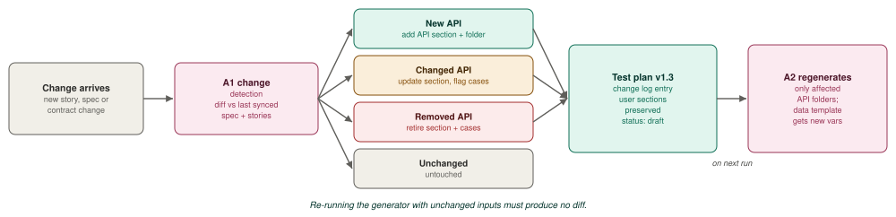

# Versioning and change tracking

Basics only. The detailed rules are in [design chapter 6](design/06-versioning.md).

## What carries a version

| Item | Version | Recorded in |
|---|---|---|
| Spec | Git commit | `sources.lock` |
| API contract | Contract version, plus a fingerprint per operation | `sources.lock` |
| User story | Last update time, plus a fingerprint per acceptance criterion | `sources.lock` |
| Instruction file or wiki page | Page version and fingerprint (never content; pages are read live) | `sources.lock` |
| Test plan | Plan version plus a version per API section | Plan header, `CHANGELOG.md`, git tag |
| Test case | The plan version, section version, and criteria fingerprints it came from | The case file |
| Framework | Release version | `agent.yaml` and every run record |

## How a change flows

1. The plan generator snapshots every source and compares it with `sources.lock`.
2. Each difference is classified: new API, additive change, breaking change, removed API, criterion added, changed, or removed, instruction changed, or a conflict between sources.
3. Only affected plan sections change; the plan version and change log are updated, and the new snapshot is written to `sources.lock`.
4. A case whose recorded fingerprints no longer match is no longer valid. The case generator never rewrites it: it marks it `obsolete`, tags it `obsolete` and `obsolete:<reason>`, and writes a new case for the changed requirement. Unchanged inputs write nothing. See [design 6.5](design/06-versioning.md#65-change-policy-obsolete-and-add-never-overwrite).
5. New cases record the service version they apply from; until that version is deployed, the executor reports them as pending, not failed.

## Classification and version bumps

| Change | Effect | Bump |
|---|---|---|
| New API | New plan section, new API folder, new cases | Minor |
| Additive API change | Section updated, cases added | Minor |
| Breaking API change | Affected cases obsolete and replaced by new cases | Major for that API section |
| API removed | Section retired; cases obsolete | Major for that API section |
| Criterion added, changed, or removed | New cases added; cases for a changed or removed criterion obsolete | Minor |
| Instruction or wiki page changed | Affected sections re-read and updated | Minor |
| Sources disagree | Listed as a requirement gap; affected cases blocked | None |

## Resolved in the design

Version numbering, what counts as breaking, which ticket statuses trigger updates, how the deployed version is discovered, side-by-side API versions such as `/v1` and `/v2`, merging into hand-edited cases, and how workflows track the API versions they call are all settled in [design chapter 6](design/06-versioning.md).
